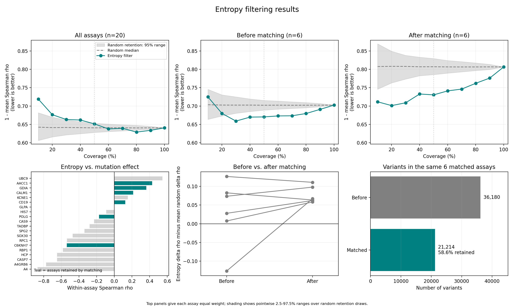

<div align="center">

# ESM-2 Confidence Filter

**Do ESM-2 predictions from low-entropy positions agree better with experimental results?**

[](https://www.python.org/)
[](https://pytorch.org/)
[](https://huggingface.co/facebook/esm2_t33_650M_UR50D)
[](https://proteingym.org/download)

</div>

## Overview

ESM-2 is a protein language model trained on millions of protein sequences. It learns patterns in amino-acid sequences and can predict how substitutions affect a protein. However, its scores don't say how reliable each prediction is.

Positional entropy measures how spread out ESM-2’s amino-acid probabilities are at each position. I tested whether predictions from low-entropy positions agreed better with experimental measurements.

On 20 ProteinGym assays, I compared three sets of predictions: those from low-entropy positions, the full set, and random subsets of the same size as the low-entropy set. I used Spearman correlation to measure how well the predicted and experimental rankings agreed.

## Results

**Entropy filtering improved ranking on average across the six assays that passed the matching controls. Across all 20 assays, it gave no clear improvement.**

For the matched analysis, I balanced experimental effect sizes between the entropy groups and checked how much the experimental scores varied.

| Analysis                         | Assays | Mean change in Spearman at 50% coverage | 95% bootstrap interval |
| -------------------------------- | -----: | --------------------------------------: | ---------------------: |
| All assays                       |     20 |                                 -0.0108 |     [-0.0423, +0.0212] |
| Same six assays, before matching |      6 |                                 +0.0322 |     [-0.0374, +0.0889] |
| After matching                   |      6 |                                 +0.0761 |     [+0.0612, +0.0931] |

Coverage is the fraction of variants kept in each assay. A positive change means filtering raised Spearman compared to using all variants in the same dataset. Every assay is weighted equally and the intervals come from resampling assays.

- Better than random in the matched subset: the mean improvement over random retention was +0.0765, with a 95% bootstrap interval of [+0.0618, +0.0934].
- Benchmark check: all 15 directly comparable assays reproduced ProteinGym's published ESM-2 correlations within the specified 0.02 tolerance. The other five had published benchmarks that included multi-mutants excluded here.
- Cost of matching: six assays were usable, keeping 21,214 of 36,180 variants (58.6%).

<div align="center">



</div>

The top panels compare entropy filtering to random filtering. Lower values mean better ranking. Shaded bands show the 95% range across random draws at each coverage level. The table uses bootstrap intervals.

You can check the [summary table](outputs/headline_table.csv), [per-assay results](outputs/headline_per_assay.csv), and [scoring audit](outputs/scoring_integrity.json).

## Installation

Requires **Python 3.10 or newer**. You can run the saved-score analysis without a GPU. Scoring new variants with ESM-2 needs an NVIDIA GPU and CUDA-enabled PyTorch.

```bash
git clone https://github.com/AmiraliAhm4di/esm2-confidence-filter.git
cd esm2-confidence-filter
python -m venv .venv
```

Activate the environment using the command for your system:

```bash
# Windows PowerShell
.\.venv\Scripts\Activate.ps1

# macOS / Linux
source .venv/bin/activate
```

Install the project and its test dependencies:

```bash
python -m pip install -e ".[test]"
```

## Usage

Run these from the repository root. Saved scores and outputs are included so you can regenerate the main tables and figure without downloading raw data or rerunning ESM-2:

```bash
python -m scripts.analyze
python -m scripts.final_figures
```

These commands update the headline tables, results memo, and `outputs/final_analysis.png` using the saved filtering and random-filtering results.

<details>
<summary><strong>Rebuild the analysis from saved variant scores</strong></summary>

Run these steps in order to recompute filtering, random baselines, matched controls, and the final summaries:

```bash
python -m scripts.abstain
python -m scripts.random_null
python -m scripts.analyze_confound
python -m scripts.variance_matched_control
python -m scripts.analyze
python -m scripts.final_figures
```

The random baselines use 1,000 draws at each coverage level, so this takes longer than regenerating the summaries alone. Random choices use seed 42.

</details>

Run the tests with:

```bash
python -m pytest
```

Tests cover mutation parsing, random-filtering counts and reproducibility, and position matching. For the study design and raw-data locations, see [METHODS.md](METHODS.md) and [data_sources.csv](data/data_sources.csv). The repository does not include the raw ProteinGym files.

## Limitations

Filtering helped in the six assays left after matching but that is not enough to conclude that entropy works as a confidence measure in general.

- Matching uses the experimental scores to balance effect size and check how much the scores vary. It's an analysis control so you can't use it on a protein that hasn't been measured.
- Only 6 of the 20 assays passed those controls. The change in the filter's advantage over random (before vs. after matching) has an interval that includes zero so I can't say matching made the advantage stronger.
- Entropy is the same for every substitution at a given position. It can't tell you the probability that any single prediction is correct.

I want to run the same analysis on more assays and see whether other uncertainty measures work better than entropy.

## Why I built this

I wanted to see if a protein language model like ESM-2 makes worse predictions at positions where it's less sure. So I used ProteinGym’s experimental measurements to check whether keeping predictions from low-entropy positions improved the results.

The results were mixed. I checked whether the low-entropy positions had different experimental effect sizes and whether keeping variants at random worked just as well as filtering by entropy.

## Contact

[@AmiraliAhm4di](https://github.com/AmiraliAhm4di)
